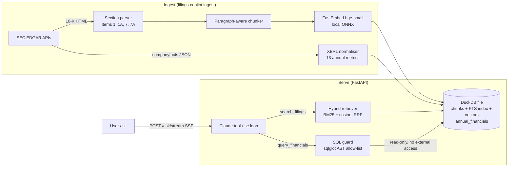

# filings-copilot

**An agentic research assistant for SEC 10-K filings that never makes up a number.**

Ask *"Why did NVIDIA's gross margin rise in FY2025, and to what level?"* and the agent
pulls the figure from audited XBRL data with SQL, finds management's explanation in the
filing text with hybrid search, and answers with citations that link to the source filing.


> Demo GIF / live link: _coming with the web UI (see roadmap)_

---

## Why this exists

LLMs are good at reading 10-Ks and bad at arithmetic and recall. In finance a confident
wrong number is worse than no answer. The design splits the work the way an analyst would:

| Question part | Source | Tool | Why |
|---|---|---|---|
| "How much / what %" | XBRL financial facts (audited, structured) | `query_financials`: guarded text-to-SQL on DuckDB | Numbers are computed, not generated |
| "Why / what risks" | 10-K narrative (Item 1, 1A, 7, 7A) | `search_filings`: BM25 + vector search, RRF fusion | Quotes the filer's own words, cited |
| "Is this even in the data?" | `list_companies` | metadata lookup | Lets the agent say "not available" |

## Architecture



## Results

### Data correctness (XBRL normaliser vs. published figures)

| Company | Metric | filings-copilot | Reported in 10-K |
|---|---|---|---|
| NVIDIA | Revenue FY2025 | $130.497B | $130.497B |
| NVIDIA | Gross margin FY2025 / FY2024 | 75.0% / 72.7% (computed in SQL) | "increased to 75.0% … from 72.7%" (MD&A text) |
| Apple | Revenue FY2025 | $416.161B | $416.161B |
| Microsoft | Revenue FY2024 | $245.122B | $245.122B |

The gross-margin row is the core idea in one line: the number comes from structured data,
the explanation from the text, and the two independent sources agree.

### Retrieval (offline, `filings-copilot eval --retrieval-only`)

8 narrative questions over 3 companies x 2 fiscal years (1,009 chunks). A hit means a
top-5 passage comes from the expected company + 10-K section and contains the key term.

| Setting | Recall@5 | MRR |
|---|---|---|
| Ticker filter (how the agent searches) | 0.875 | 0.812 |
| No filter (retrieval must find the company too) | 0.875 | 0.812 |

Median query latency ~200 ms on a laptop CPU (embedding + BM25 + vector scan).

**Failure analysis.** The one miss is a two-part question: *"Which manufacturing partners
does NVIDIA depend on, and what supply chain risks does it flag?"* "TSMC" appears only in
Item 1, while one combined query ranks Item 1A risk passages higher. The agent can recover
by issuing two searches; the retrieval benchmark deliberately keeps the hard case to
measure whether query decomposition helps.

### End-to-end agent (`filings-copilot eval`)

20 golden questions: 10 numeric (graded against XBRL with tolerances), 7 narrative +
1 mixed (graded on citation to the right section and key terms), 2 unanswerable (graded
on abstaining). Grading is deterministic: no LLM judge, so a score change means the
system changed, not the grader.

_Not yet published. Requires an Anthropic API key; the run reports pass rate by kind,
numeric / citation / abstention accuracy, p50/p95 latency and cost per question._

## Design decisions

- **DuckDB as the only datastore.** One embedded file gives SQL for metrics, BM25 (`fts`
  extension) and vector similarity (`array_cosine_similarity`). No vector DB to run; the
  Docker image ships the data file. Brute-force cosine is fine at this scale (~10k chunks);
  an HNSW index (`vss`) is the next step past ~1M.
- **Reciprocal Rank Fusion** instead of weighted score blending: BM25 and cosine scores
  live on different scales, ranks don't.
- **Normalised metrics instead of raw XBRL.** Revenue alone has 3+ concept names across
  filers; restatements repeat values in later filings. The loader picks concepts by
  priority, keeps true annual durations (350–380 days), and lets the latest filing win.
  The model sees `metric = 'revenue'`, not `RevenueFromContractWithCustomerExcludingAssessedTax`.
- **SQL safety in two layers.** `sql_guard` parses the query with sqlglot and allows one
  `SELECT` over three tables (CTEs, joins, window functions fine; file readers, `PRAGMA`,
  `ATTACH`, `COPY`, qualified names rejected; row limit enforced). Underneath, the
  serving connection is read-only with `enable_external_access = false` and locked config,
  so even a guard bypass cannot write or read files. 18 attack cases are in the tests.
- **Hand-rolled agent loop that yields events.** CLI, SSE API and the eval harness share
  one code path; every tool call is observable with its latency and token usage.
  Claude Opus 5.5 with adaptive thinking, prompt caching on the system prompt, and
  server-side refusal fallback.
- **Messy-real-world handling found during development:** filers that repeat
  "PART I / Item 1A" as running page headers (Microsoft) broke naive section splitting;
  NVIDIA reports capex as `PaymentsToAcquireProductiveAssets`; www.sec.gov over broken
  IPv6 times out while data.sec.gov works (`FILINGS_SEC_FORCE_IPV4=true`). Each one has a
  regression test.

## Quickstart

```bash
git clone https://github.com/tantn89/filings-copilot && cd filings-copilot
python -m venv .venv && source .venv/bin/activate      # Windows: .venv\Scripts\activate
pip install -e ".[dev]"
cp .env.example .env                                     # set FILINGS_SEC_USER_AGENT + ANTHROPIC_API_KEY

filings-copilot ingest --tickers NVDA,MSFT,AAPL --years 2024-2025   # ~5 min on CPU
filings-copilot ask "Why did NVIDIA's gross margin rise in FY2025, and to what level?"
filings-copilot eval --retrieval-only                                 # free, offline
filings-copilot serve                                                 # http://127.0.0.1:8000/docs

cd web && npm install && npm run dev                                  # http://localhost:3000
```

The UI reads the API from `NEXT_PUBLIC_API_URL` (default `http://127.0.0.1:8000`).

Tests run fully offline (fake Claude client, hashing embedder, mocked EDGAR, in-memory DuckDB):

```bash
pytest --cov=filings_copilot    # 57 tests, 86% coverage
ruff check src tests && mypy    # strict typing
```

## Choosing a model

Claude is the default (`FILINGS_LLM_PROVIDER=anthropic`, native SDK with adaptive thinking,
prompt caching and refusal fallback). Any other model runs through OpenRouter:

```bash
FILINGS_LLM_PROVIDER=openrouter
FILINGS_LLM_MODEL=<provider/model from openrouter.ai/models>
OPENROUTER_API_KEY=...
```

`openai_compatible_client.py` translates the Anthropic-shaped tool loop to chat-completions
and back, so tools, the SQL guard and the eval harness are identical across models. That
makes `filings-copilot eval` a like-for-like model comparison: OpenRouter reports the billed
cost per call, which the eval report uses for cost per question.

## Deploy

- **API → Hugging Face Space (Docker).** `python scripts/deploy_hf_space.py --space <user>/filings-copilot-api`
  uploads the image source plus the pre-built DuckDB file, stores LLM keys as Space secrets,
  and refuses to deploy without a daily question cap: every public question costs credits.
- **UI → Vercel.** Root directory `web/`, env `NEXT_PUBLIC_API_URL=<Space URL>`; then set
  `FILINGS_CORS_ORIGINS` to the Vercel URL and redeploy the API.

## API

| Method | Path | Returns |
|---|---|---|
| `POST` | `/ask` | `{answer, citations[], tool_calls[], input_tokens, output_tokens, latency_s}` |
| `POST` | `/ask/stream` | Server-sent events: `tool_call`, `tool_result`, `answer` / `error` |
| `GET` | `/companies` | Tickers and fiscal years available |
| `GET` | `/health` | Filing and chunk counts |

## Project layout

```
src/filings_copilot/
  edgar_client.py            SEC APIs: rate limit, retries, User-Agent policy
  tenk_section_parser.py     HTML -> text -> Items, TOC and page-header aware
  text_chunker.py            paragraph-packing chunker with overlap
  financial_facts_loader.py  XBRL companyfacts -> tidy annual metrics
  filings_store.py           DuckDB schema, FTS index, read-only lockdown
  hybrid_retriever.py        BM25 + vector + RRF with filters
  sql_guard.py               AST-based read-only SQL validation
  agent_tools.py             tool schemas (strict) + executors
  research_agent.py          Claude tool-use loop emitting events
  evaluation.py              deterministic retrieval + agent grading
  http_api.py / cli.py       FastAPI + Typer entry points
evals/golden_questions.jsonl  20 graded questions with XBRL ground truth
```

## Roadmap

- [x] Next.js UI (`web/`): live tool trace with the exact SQL, citation chips linked to
      source passages and SEC.gov, shareable `/?q=` question links
- [ ] Publish full agent eval; compare effort levels (cost vs. accuracy)
- [ ] Query decomposition for multi-part questions (target: the TSMC miss)
- [ ] Deploy: API on Cloud Run, UI on Vercel
- [ ] OpenTelemetry traces per tool call
- [ ] Scale to S&P 100 with incremental ingest and `vss` HNSW index

## License

MIT
